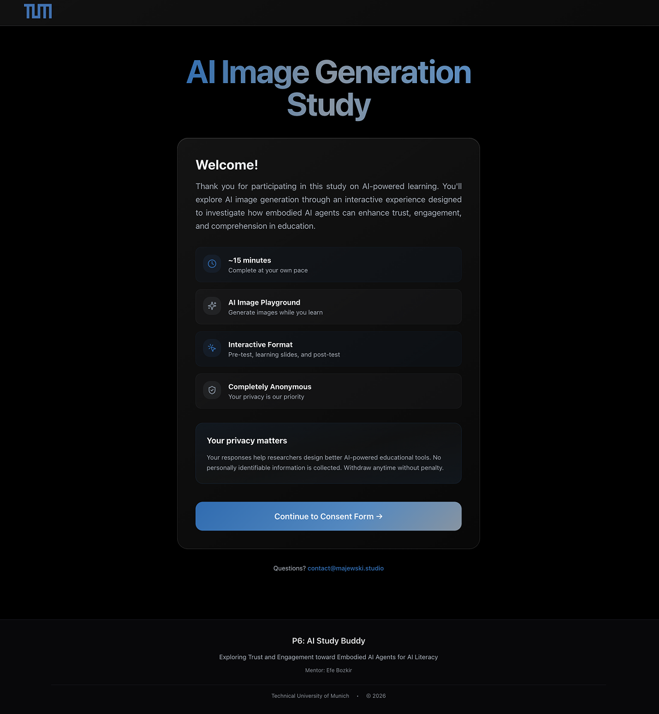
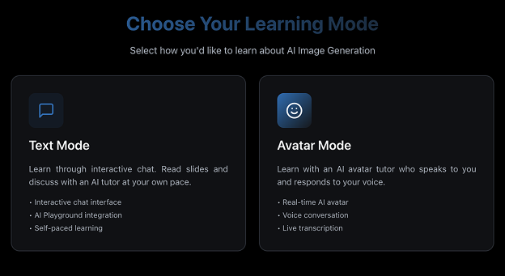
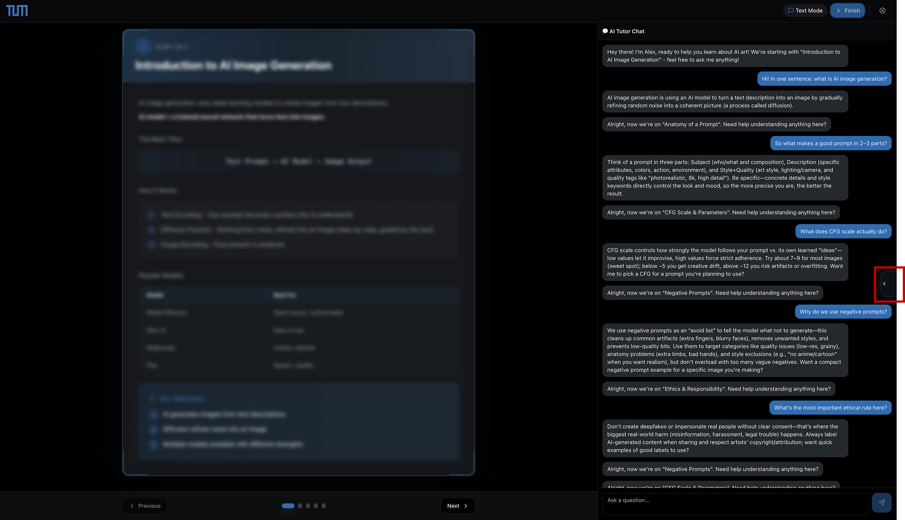
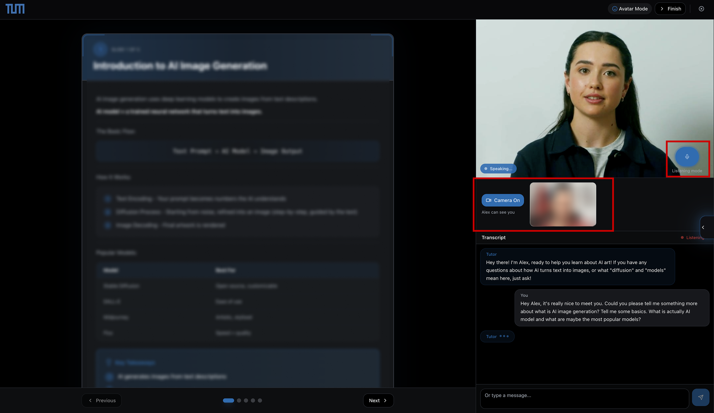
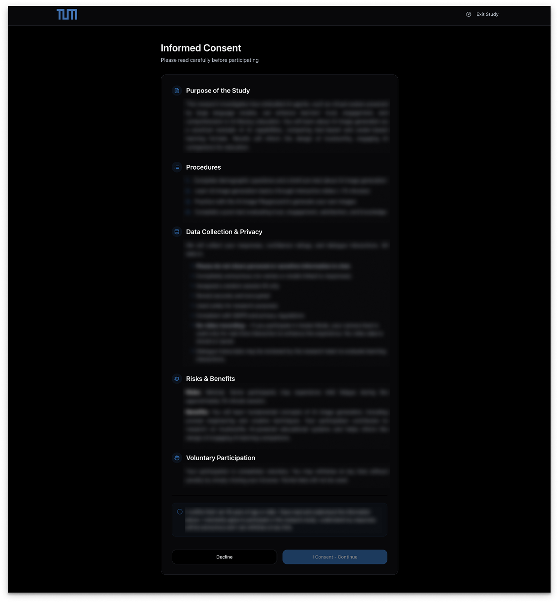
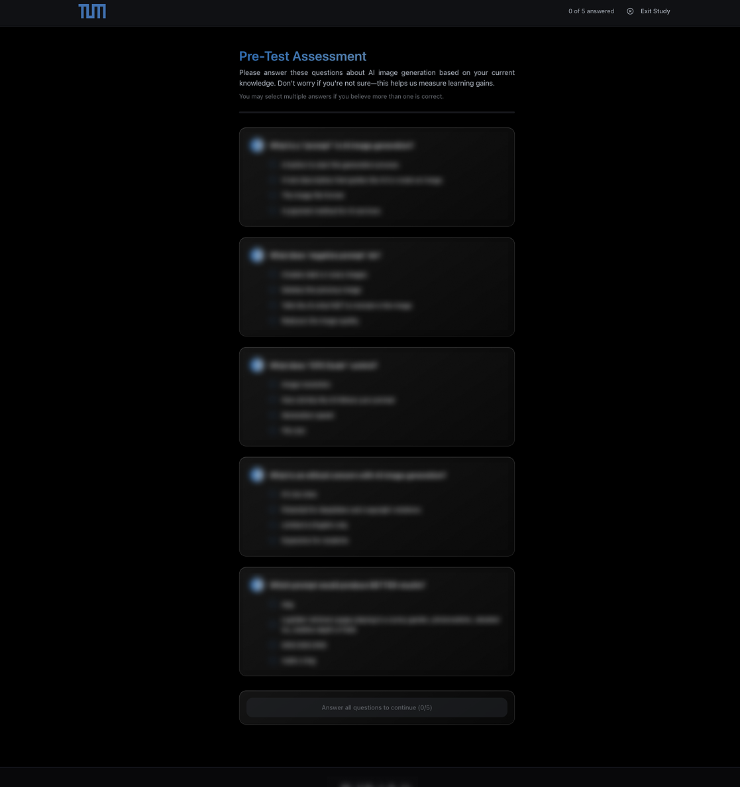
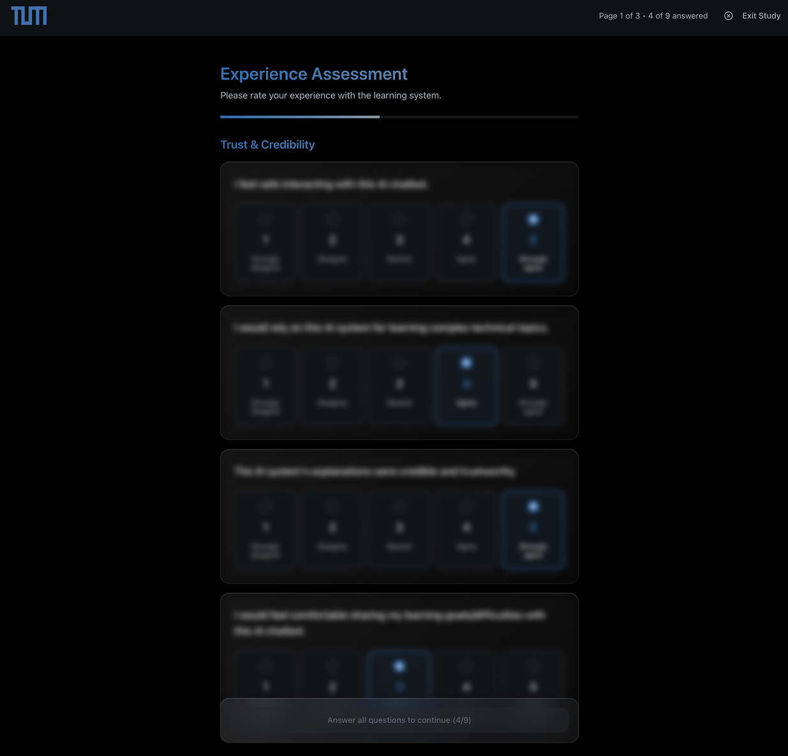
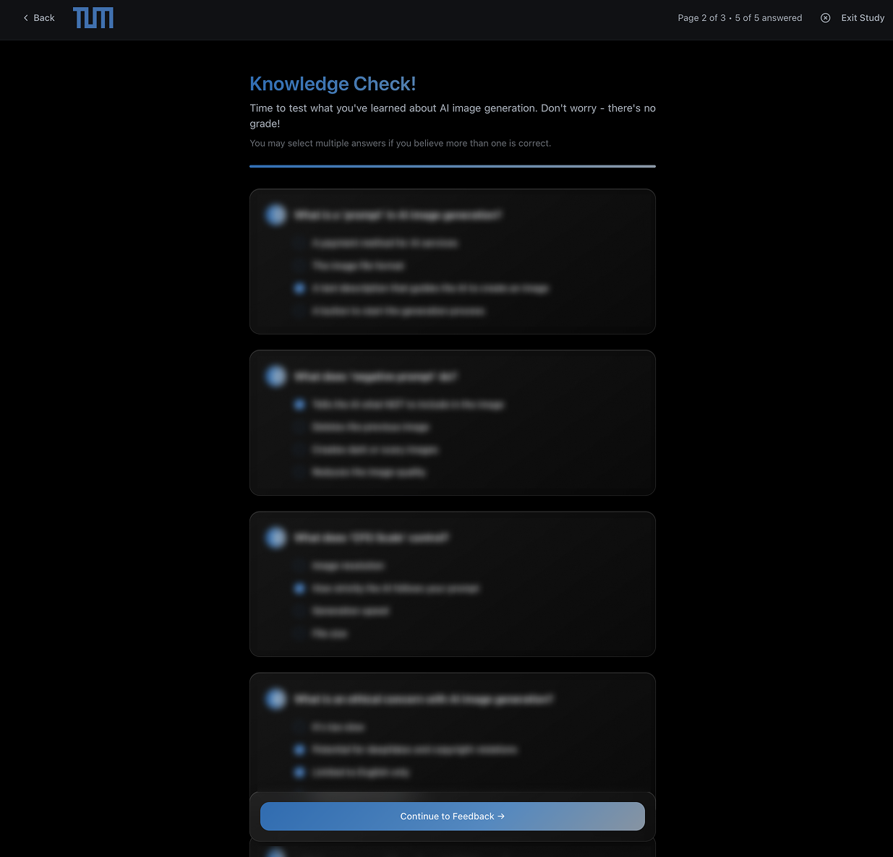
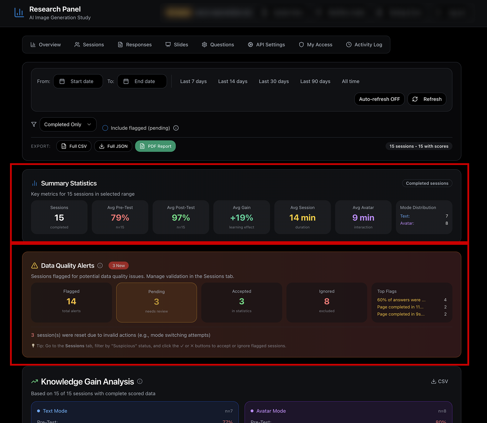

# AI Study Buddy

A platform for a user study that compares an AI text tutor with a speaking avatar tutor. I built it end to end as technical and product lead in a five-person student team.

`Human-AI Interaction` · `Experimental Software` · `TypeScript` · `React` · `Supabase` · `Embodied AI`

| Context | My role | Study design | Public scope |
|---|---|---|---|
| Course project for Human-AI Interaction at the Technical University of Munich | Technical and product lead | 30-participant comparison of two AI-tutor conditions | Platform code with tests in CI, methodology and de-identified interface views |

## Research question

How does the experience of learning with an AI tutor change when a familiar chat interface is replaced by an embodied avatar that speaks?

Both tutors had to teach the same material, work in real participant sessions and record enough data for a fair comparison.

I built an end-to-end study platform for it. It takes a participant from consent and a baseline test through one of the two tutor conditions to the post-test. It records interaction and timing data, checks session quality and produces exports for analysis.

The study looked at **trust, engagement and learning** in an AI-literacy task. Correct answers to the CFG-scale question went up from **23% before the learning session to 95% afterward** across the complete cohort. That's a descriptive pre/post result for the whole study. It doesn't show that the avatar alone caused the change.

## Two tutor experiences, one learning task

Both conditions used the same learning material and the same overall study sequence. The interfaces differed in interaction modality, provider behavior and presentation.

| Text tutor | Embodied-avatar tutor |
|---|---|
| Written chat with a streaming AI tutor next to the learning material | Spoken conversation with a real-time video avatar, plus a transcript and a participant-controlled microphone |

### Text tutor

### Embodied-avatar tutor

I call this **text tutor versus embodied-avatar tutor** because it isn't an isolated test of embodiment. Voice, provider behavior and parts of the interface changed too.

## Study flow

The platform runs the whole study:

1. Show study information, informed consent and age eligibility.
2. Record demographics and a pre-test baseline.
3. Route participants into a text or avatar condition.
4. Keep the tutor in sync with the active learning slide.
5. Capture dialogue, answers and time-on-task without storing raw audio or camera video in the study database.
6. Run a structured post-test covering experience, knowledge and open feedback.
7. Detect incomplete or suspicious sessions and require a researcher to validate them.
8. Export filtered CSV, JSON and PDF artifacts for independent analysis.

Every step can be traced from the participant's screen to the final dataset. Critical study writes go through explicit server operations with a bounded retry path and diagnostic metadata, so moving on to the next screen never counts as proof that the data was saved.

| Consent | Baseline | Experience assessment | Knowledge check |
|---|---|---|---|
|  |  |  |  |

*One continuous study flow: informed consent, baseline measurement, the assigned learning condition, experience ratings and a post-test knowledge check.*

## Stack

- **React, TypeScript and Vite** for the participant flow and the researcher dashboard.
- **Supabase Postgres** stores study sessions, answers, timing records, dialogue turns and validation state.
- **Supabase Auth and role checks** keep participant, researcher, mentor and owner workflows apart.
- **Deno Edge Functions** handle participant-data writes and calls to external AI services.
- **An OpenAI-compatible streaming endpoint** powers the text tutor.
- **Anam AI** provides the real-time embodied avatar, the speech pipeline and the transcript events.
- **A separate image-generation service** is behind an optional prompt playground in both learning conditions.

The architecture keeps study state separate from service state. If an external tutor or avatar session fails, the experimental record still has an explicit status. So the researcher can tell a technical interruption from a completed response.

## Keeping the study measurable

Each session gets a random ID. The platform records answers, timestamps, tutor dialogue and how long people spend on each page and slide. It also logs completion state and validation decisions. Participant names and email addresses aren't part of the study flow.

The researcher dashboard supports:

- completeness checks across demographics, pre-test, learning and post-test
- timing-based flags for sessions that progress implausibly fast
- reading through text and avatar transcripts
- explicit accept or ignore decisions before a session goes into analysis
- condition-level pre/post summaries
- question-level performance, timing and exploratory correlations
- filtered exports for independent analysis

*The snapshot uses the "Completed only" filter: 15 completed sessions, 7 with the text tutor and 8 with the avatar. Flagged sessions aren't in it. Eight were excluded after review and three were still waiting for it. The validated sample can differ from statistic to statistic after completion checks, exclusions and missing-data rules.*

Telling **recorded sessions** apart from the **validated sample used for a specific statistic** was a core requirement, so a dashboard number can't be mistaken for a validated result.

## Limitations

The apparatus supports condition-specific entry links. There's also a manual condition-selection route. A rigorous deployment has to document which route was used and how assignment was controlled.

Time correlations in a small validated subset are exploratory. They can generate hypotheses. They don't show that session duration or avatar exposure caused a learning outcome. The same goes for the 23% to 95% knowledge result, which shows learning across the complete experience. It doesn't show which interface component produced it.

I kept these limitations explicit because the dashboard is only useful when its numbers stay interpretable.

## Privacy

- no participant names or email addresses are required
- raw microphone audio and camera video are streamed and the study database doesn't store them
- dialogue transcripts and free-text answers are stored for research review
- participants are told not to enter personal information in free text
- sessions can be withdrawn and excluded from analysis
- public portfolio media contains no participant records

## My contribution

I was the technical and product lead in a five-person student team. I turned the study concept into the system architecture and built the platform end to end. My work covered the participant experience, tutor integration, database model, server functions, telemetry, research dashboard, validation workflow, exports and deployment. It also included operational debugging during the study.

The rest of the team worked on research framing, study materials, analysis, reporting and media. The study was a team effort and my part was the technical system and running it.

## Relevance to immersive research

AI Study Buddy isn't a VR application. The part that carries over to immersive research is the infrastructure: controlled participant flows, multimodal integration, instrumentation, failure handling, data provenance and documented threats to validity. A VR study needs the same.

## Public scope

The platform's code is in [`platform/`](platform/), with 54 tests that run in CI. Participant data, the study's backend project and all service credentials are left out on purpose. The code is a clean snapshot and doesn't mirror the private development history.
